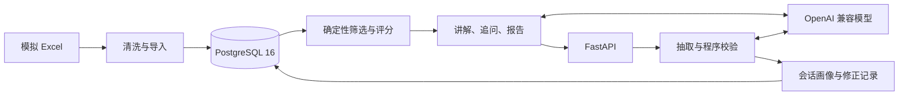

# 面试讲解笔记

系统面向模拟的未来职业规划。把原始 Excel 清洗成可查询的岗位和标签资料，从咨询发言提取有证据的意向，算出可解释的候选与排序，再生成可核对的讲解和规划报告。

## 系统架构

`app/main.py` 定义接口，`app/db.py` 提供 PostgreSQL 连接和批量 upsert。`app/etl.py` 处理数据与批次报告。`app/extractor.py` 和 `app/profile.py` 管抽取、合并、证据与确认。`app/matcher.py` 实现匹配，`app/advisor.py` 和 `app/report.py` 组织咨询输出。

## 数据库设计

| 表或组合 | 作用与关键约束 |
|---|---|
| `jobs`、`tag_definitions`、`job_tags` | 岗位、允许值与岗位标签的长表。`job_tags` 以 `(job_id, tag_id)` 为主键，保存标签值和事实依据。城市、方向、资格标签由岗位字段派生。城市、方向及 `(tag_id, value)` 有索引。 |
| `knowledge_docs` | 以岗位 ID 关联资料，保存正文和使用限制。导入的通用资料用空岗位 ID 表示，讲解接口读取指定岗位的资料。 |
| `sessions`、`dialogue_turns` | 会话与带角色的原话。`(session_id, turn_no)` 唯一。 |
| `user_preferences`、`preference_suggestions`、`preference_changes` | 正式偏好、待确认建议和变更历史。变更保存旧值、新值及原话轮次。JSONB 支持单值、多选及加班复合值。 |
| `user_qualifications` | 按会话存当前学历、政治面貌和经验，供准备提示。 |
| `import_runs`、`import_issues` | 保存批次和问题，支持查最近一批及历史批次。 |

导入先按工作表的真实表头解析。P006 的一致重复合并，内容冲突用最新版本，无法判断时记异常并隔离。关键字段缺失仍保留可追溯记录。导入和岗位写接口分别使用事务，字段和派生标签一并更新。

## 大模型与程序职责

- **抽取**。模型收到本轮角色、原话、最近三轮及字典，返回 JSON 提议。程序用 Pydantic、字典、原话子串和角色进行校验，限制硬条件标签。咨询师的问句只记发言。`set` 覆盖、`add` 追加、`remove` 移除；真正变化写入历史。
- **待确认建议**。从「不喜欢天天埋头整理资料」间接推断的 T007、T012 放入建议表。只有显式接口确认后才进入正式画像。确认会检查会话、原发言 ID 和建议状态。
- **岗位讲解**。模型在指定岗位的字段、标签和知识资料中挑选短句。程序检查来源、原文和禁用表达，再拼成结构化讲解。资料缺失时显示「资料未提供」。
- **智能追问与报告**。程序计算哪些尚未明确的标签最能区分候选，模型改写问句。推荐顺序、未知项和资格差距由程序计算，模型只选择并排列资料支持的建议。

## 匹配和追问如何计算

1. 先取 `is_matchable=true` 的岗位。T001、T002 做集合命中，T003 按 `无 < 偶尔 < 频繁` 检查出差上限。已知硬条件失败就剔除，未知保留并标记 `pending_confirmation`。
2. 软偏好按命中或顺序距离给 1、0.5、0 分。收入高于首选可以满分，软上下限内给满分。对「首选少，接受到偶尔」，少 1 分、偶尔 0.5 分、经常 0 分。
3. 总分是已知项平均值，明确不匹配的 0 分仍参与平均。P012 的稳定性和群众接触分别为 1、0.5，收入未知，所以总分 `(1+0.5)/2=0.75`。同时展示已评分和未知项数。无可评项时返回 `null`，同分按岗位 ID 排序。
4. 用资格字段单独生成准备提示。S-C 的 P008 因岗位为硕士参考、需 2 年经验而给出准备项，仍出现在候选结果里。
5. 追问区分度等于已知候选覆盖率乘以 `1−Σp²`，`p` 是各已知标签值的比例。只考虑未生效的非资格偏好标签。同分按标签 ID，无有效差异时返回空列表。

## 异常处理与已知边界

- 模型响应结构异常时，抽取返回 502，失败发言和画像更新均不入库。单条不合法提议被丢弃，同一回复中的其他有效提议仍可处理。讲解、追问和报告使用资料支持的回退。
- 数据库失败由事务回滚。重复导入会更新业务数据并保留新批次报告。重复提交同一句对话仍产生新轮次，结果相同时不增加正式偏好修正；重复确认已处理的建议返回 404。
- 原话校验可以证明所引用片段确实出现，复杂同义表达和语义判断仍取决于模型。知识库按岗位 ID 查询，考核环境使用同步调用、少量模拟数据和本地 Swagger。学历比较覆盖字典中的本科和硕士，资料不足统一提示确认。
- 原题中的行业筛选按本项目标签字典对应的「职业方向」实现，样本用体制内、央国企、大型私企三个值。

## 面试中的扩展说明

- **百万岗位、数千标签**。把硬条件下推到索引或位图，先缩小候选再评分。可用 OpenSearch 承载复杂过滤，常用维度做宽表物化，预计算稳定标签并缓存热门画像结果。按实际吞吐规划分区、读写分离及更新一致性。
- **实时语音转写**。WebSocket 流式接入 ASR，先做说话人区分，再按句子边界提交 `/turns`。推进行为可做成带序号的异步抽取，增量更新画像并保留原话证据。

演示时可现场说明一个简单改动。调整报告默认 `top_n` 只涉及接口默认值与对应的展示断言，匹配引擎仍返回完整的确定性排序。验收基线分别是 S-A 6 → 11、S-B 17、S-C 4 → 11。
